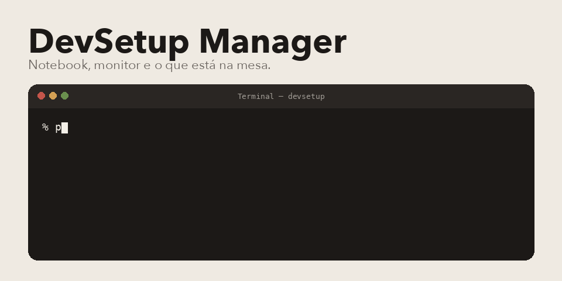

<p align="center">
  
</p>

DevSetup Manager é o inventário de TI que eu fiz na disciplina de Programação Web. Um lugar simples para cadastrar notebook, monitor e periférico, ver o total, o valor somado e o que está em manutenção.

O nome do repositório continua o da entrega da matéria. O produto é o DevSetup Manager.

## Do que é feito

Python, Flask e SQLite. O HTML é semântico. O CSS é na mão, partido em configuração, base, layout, componente e módulo, dentro de `static/css/`. Os templates Jinja herdam o `base.html`. O ícone vem do Lucide, e é o único script de fora.

As rotas são as da imagem: `/` mostra o painel, `/cadastro` grava, `/listar` busca por nome ou categoria, `/exportar` devolve o CSV.

## Subir

```bash
python3 -m venv .venv
source .venv/bin/activate
pip install flask
python app.py
```

Abre em http://127.0.0.1:5000. O banco `banco.db` nasce sozinho na primeira execução.

Professor, o obrigado continua de pé. A paciência com a turma e o cuidado na hora de ensinar ficaram neste trabalho.

Pedro Américo Paletot, [peamericoo](https://github.com/peamericoo).
